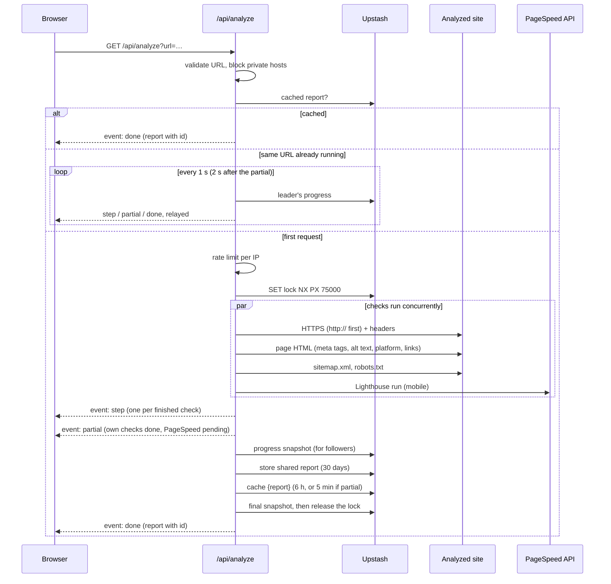

English | [Português (Brasil)](ARCHITECTURE.pt-BR.md)

# Architecture

One Next.js app (App Router, TypeScript). Each language has its own root layout; the scanner is a client island inside it, and the analysis runs in one API route. Upstash Redis holds the cache, the rate limit, the analysis locks and the shared reports. There's no other database.

## Modules

| Path | Responsibility |
|---|---|
| `app/pt-BR/`, `app/en/` | Root layout, home, report route, 404 and preview images per language (thin files) |
| `app/_shared/` | What those files render: root layout and metadata, `Scanner`, report page, preview images, error page |
| `app/_shared/Scanner.tsx` | The client island: form, progress, report and next step, with `<Activity>` and `<ViewTransition>` |
| `app/hooks/useAnalysis.ts` | Starts an analysis and reads the event stream |
| `app/hooks/useReportLink.ts` | Keeps each screen in browser history and the report at its own address |
| `app/components/` | One component per screen or report section |
| `app/i18n/` | One dictionary per language, the helpers that use them, locale constants |
| `app/api/analyze/route.ts` | Validation, cache, lock, rate limit, streaming |
| `lib/runAnalysis.ts` | Runs the checks concurrently and emits steps and the partial report |
| `lib/buildReport.ts` | Builds the partial and the final report the same way |
| `lib/analysisEvents.ts` | The stream's event types, shared by server and client |
| `lib/inflight.ts` | Lock and progress sharing for identical concurrent analyses |
| `lib/reportStore.ts`, `lib/reportId.ts` | Shared reports and their ids |
| `lib/checks/` | One file per check; HTML parsers share one page fetch |
| `lib/safeFetch.ts` | The only way the server fetches an analyzed site (SSRF guard) |
| `lib/score.ts` | Scores, including categories still being measured |
| `lib/issues.ts`, `lib/passes.ts` | Findings, their ranking, and what passed |
| `lib/cache.ts`, `lib/rateLimit.ts`, `lib/kv.ts` | Upstash Redis, with an in-memory fallback |
| `proxy.ts`, `lib/csp.ts` | Locale redirect, locale cookie and per-request CSP nonce |

## How a scan runs

Timeouts are 8 s for the site's own checks, 3 s per link and 50 s for PageSpeed. If the site has no usable HTTPS, a check that failed over `https://` retries once over `http://`. Closing the tab aborts the checks still running.

## API

`GET /api/analyze?url=<address>`

| Response | When |
|---|---|
| `200` `text/event-stream` | The analysis, or the cached report |
| `400` `{ code }` | `missing-url`, `invalid-url`, `blocked-url` |
| `429` `{ code: "rate-limited", retryAfterSeconds }` | Per-IP limit reached; also sends `Retry-After` |

Events (`lib/analysisEvents.ts`):

| Event | Data | When |
|---|---|---|
| `step` | `{ step }` | Each finished check |
| `partial` | `AnalyzeReport` with `inProgress: true` | At most once: our own checks are done, PageSpeed isn't |
| `done` | `AnalyzeReport` with `id` | The final report |
| `failed` | `{ code }` | No check produced anything |

After a `partial`, the stream always ends in `done`, since results only grow. The client reads the stream with `fetch`, not `EventSource`, so it can see error status and body.

## Partial report

The partial report goes out once `https`, `page`, `sitemapRobots` and `brokenLinks` have all settled and PageSpeed hasn't. Waiting for the page fetch matters: before it, Lighthouse's audits would stand in for the title and viewport checks and could then be replaced. `aggregateScore(results, failures, pending)` is the same function as for the final report:

- a category with a measurement and a pending source gets a provisional score with `pending: true`;
- a category with nothing measured yet is `{ score: null, severity: "pendente" }`;
- the overall score waits for the final report.

## Redis

| Key | Holds | TTL |
|---|---|---|
| `analysis:v2:<origin><path>` | `{ report }`, with its share id | 6 h, or 5 min when a check failed |
| `inflight:<origin><path>` | The leading run's id (the lock) | 75 s |
| `inflight:<runId>:state` | `{ steps, partial?, final?, failed?, aborted? }` | 120 s |
| `report:<id>` | `StoredReport` (version, id, targetUrl, domain, report, dates) | `REPORT_TTL_DAYS`, default 30 days |
| `ratelimit:<ip>` | Request timestamps (sorted set) | 1 h |

The cache key ignores query and hash, which are usually tracking parameters. `http://` and `https://`, `www.` and a trailing slash stay separate keys because they are different inputs.

**Coalescing.** The first request takes the lock with `SET NX PX` and publishes a snapshot on each step. Requests that find the lock follow those snapshots and aren't charged against the rate limit, since they cost no PageSpeed quota. The lock always expires. Releasing it is compare-and-delete, so a late leader can't free a newer one's lock. If the leader's visitor leaves, the run is marked aborted; a follower checks the cache, then runs the analysis itself once, through the rate limit. If Redis fails, the request runs uncoalesced. Without Redis, the same logic runs in memory per instance, with expired entries swept on write.

**Failures.** The client retries a Redis call twice (not Upstash's default five), so an outage can't push a request past `maxDuration`. Redis errors are logged without the command they carry, which would include visitor IPs, analyzed URLs and reports.

## Shared reports

The leader stores the final report under a 10-character base62 id (`crypto.getRandomValues`, about 59 bits) and caches it with that id, so a cache hit gives the same link. If the save fails, the report is sent without a link rather than with one only that server could open. The client moves the address to `/<locale>/report/<id>` with native `pushState`/`replaceState`; Next keeps the current tree for those entries, so back and forward never refetch. The next step is a history entry with the same address, not a route. Each entry also carries the analysis it belongs to, so back and forward never show one analysis's report for another; a reload on the next step comes back to the report.

`/<locale>/report/[id]` reads the store on the server and renders the same `Scanner` in report stage. It imports the report screens directly; the home page loads them on demand and starts fetching them when an analysis starts. Unknown or expired ids show an expired page with a link to a new analysis. A storage error shows a per-locale error page with a retry button instead, since the report may still exist. Report pages are `noindex`, with canonical, hreflang and a preview image (domain, overall score, categories, date).

## Languages and CSP

`/` and any path without a locale redirect to `/pt-BR` or `/en`: `?lang=` first, then the `isdias-lang` cookie, then `Accept-Language`. Each language has its own root layout, because with one layout Next would send both dictionaries. `npm run check:bundle` fails if that regresses. Switching language is a plain link to the other locale's address.

`proxy.ts` gives every page a per-request nonce CSP; `next.config.ts` gives the static CSP to exactly the paths the proxy skips (API, static files, robots, sitemap, icon), so each response has one CSP. A nonce needs the page rendered per request, so layouts call `connection()`.

## Scoring and findings

Each category is the plain average of the measurements that could be taken (`lib/score.ts`):

- Performance: Google's performance score
- SEO: Google's SEO score, title (100/0), description (100/0), share of working links
- Accessibility: Google's accessibility score, viewport (100/0), share of images with alt text
- Security: 0 without trusted HTTPS; otherwise HTTPS (100, or 50 without the `http://` redirect) averaged with Google's best-practices score

A measurement whose check didn't run is left out, not counted as 0 or 100. A category with none is "unavailable" and carries the reason. Bands: below 50 critical, below 80 attention. Each category keeps its `components`, the points each measurement took off, rounded with the largest-remainder method so they sum to `100 − score`.

`deriveIssues` turns results into findings as a code plus parameters, so the client can word them in either language. `rankIssues` orders them by severity, then by the points their measurement costs (`COMPONENT_ISSUES`), then by derivation order. "Fix these first" is the top three that aren't suggestions.

## Errors

One failed check leaves its category "partly measured" or "not measured", with the reason. If every check fails, the stream sends one `failed` code naming the cause. If the stream drops after a partial report, the client keeps it and says Google's measurement didn't finish; the categories still waiting show as not measured and the overall score as unavailable. Raw errors and stack traces stay in the server log; the browser only gets codes.

## Decisions

- One page, not a crawl: fast and predictable scans.
- HTML read with regular expressions, not a headless browser: fast and safe for untrusted input.
- A `401/403/429/503` means "couldn't see it", never "missing".
- Codes from the server, words in the client.
- No database beyond Redis: no scan history, and shared reports expire.
- **Cache Components / Partial Prerendering: not enabled.** A nonce CSP needs every page rendered per request, and Next documents PPR as incompatible with nonces. Static prerendering of the pages is ruled out for the same reason.
- **React Compiler: not enabled.** Measured with `reactCompiler` and `babel-plugin-react-compiler`: initial JS grew from 152.2 to 160.1 KB gzip and the build from about 12.5 to 13.1 s. The app re-renders little, so there was nothing to gain for that cost.
- **Lighthouse is not in CI:** its scores vary between runs. CI checks initial JS size instead (`npm run check:bundle`).
