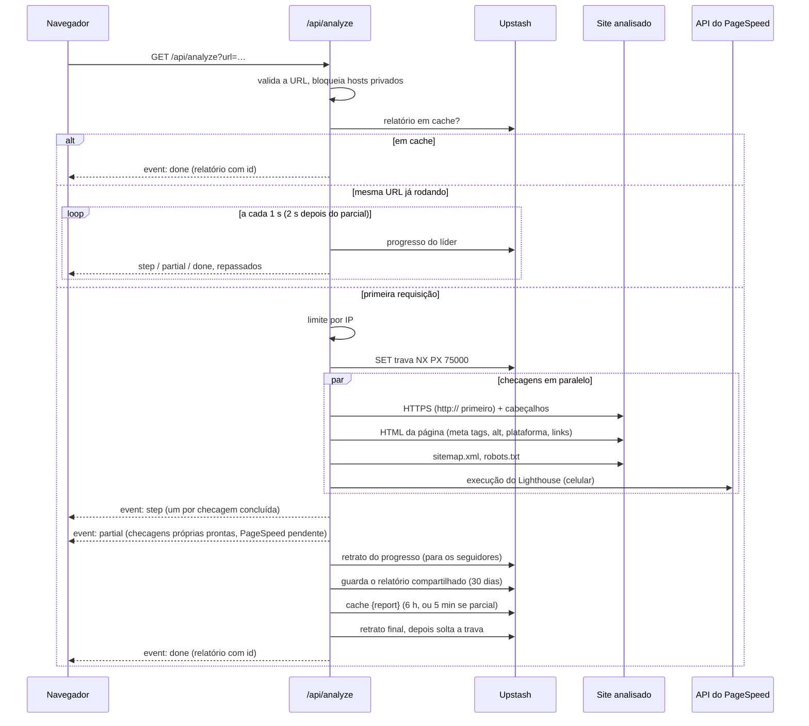

[English](ARCHITECTURE.md) | Português (Brasil)

# Arquitetura

Um único app Next.js (App Router, TypeScript). Cada idioma tem o próprio layout raiz; o scanner é uma ilha cliente dentro dele, e a análise roda numa rota de API. O Upstash Redis guarda o cache, o limite de uso, as travas de análise e os relatórios compartilhados. Não há outro banco de dados.

## Módulos

| Caminho | Responsabilidade |
|---|---|
| `app/pt-BR/`, `app/en/` | Layout raiz, início, rota de relatório, 404 e imagens de prévia por idioma (arquivos finos) |
| `app/_shared/` | O que esses arquivos renderizam: layout raiz e metadados, `Scanner`, página de relatório, imagens de prévia, página de erro |
| `app/_shared/Scanner.tsx` | A ilha cliente: formulário, progresso, relatório e próximo passo, com `<Activity>` e `<ViewTransition>` |
| `app/hooks/useAnalysis.ts` | Inicia uma análise e lê o stream de eventos |
| `app/hooks/useReportLink.ts` | Mantém cada tela no histórico e o relatório no próprio endereço |
| `app/components/` | Um componente por tela ou seção do relatório |
| `app/i18n/` | Um dicionário por idioma, as funções que os usam, constantes de idioma |
| `app/api/analyze/route.ts` | Validação, cache, trava, limite, streaming |
| `lib/runAnalysis.ts` | Roda as checagens em paralelo e emite as etapas e o relatório parcial |
| `lib/buildReport.ts` | Monta o relatório parcial e o final do mesmo jeito |
| `lib/analysisEvents.ts` | Os tipos de evento do stream, compartilhados por servidor e cliente |
| `lib/inflight.ts` | Trava e progresso compartilhado para análises iguais simultâneas |
| `lib/reportStore.ts`, `lib/reportId.ts` | Relatórios compartilhados e seus IDs |
| `lib/checks/` | Um arquivo por checagem; os parsers de HTML dividem uma busca da página |
| `lib/safeFetch.ts` | O único jeito de o servidor buscar um site analisado (proteção SSRF) |
| `lib/score.ts` | Notas, incluindo categorias ainda sendo medidas |
| `lib/issues.ts`, `lib/passes.ts` | Achados, a ordem deles, e o que está certo |
| `lib/cache.ts`, `lib/rateLimit.ts`, `lib/kv.ts` | Upstash Redis, com alternativa em memória |
| `proxy.ts`, `lib/csp.ts` | Redirecionamento de idioma, cookie de idioma e nonce da CSP por requisição |

## Como uma análise roda

Os tempos limite são 8 s para as checagens próprias, 3 s por link e 50 s para o PageSpeed. Se o site não tem HTTPS utilizável, uma checagem que falhou pelo `https://` tenta de novo uma vez pelo `http://`. Fechar a aba cancela as checagens que ainda estão rodando.

## API

`GET /api/analyze?url=<endereço>`

| Resposta | Quando |
|---|---|
| `200` `text/event-stream` | A análise, ou o relatório em cache |
| `400` `{ code }` | `missing-url`, `invalid-url`, `blocked-url` |
| `429` `{ code: "rate-limited", retryAfterSeconds }` | Limite por IP atingido; também envia `Retry-After` |

Eventos (`lib/analysisEvents.ts`):

| Evento | Dados | Quando |
|---|---|---|
| `step` | `{ step }` | Cada checagem concluída |
| `partial` | `AnalyzeReport` com `inProgress: true` | No máximo uma vez: checagens próprias prontas, PageSpeed não |
| `done` | `AnalyzeReport` com `id` | O relatório final |
| `failed` | `{ code }` | Nenhuma checagem produziu nada |

Depois de um `partial`, o stream sempre termina em `done`, porque os resultados só crescem. O cliente lê o stream com `fetch`, não `EventSource`, para ver o status e o corpo dos erros.

## Relatório parcial

O relatório parcial sai quando `https`, `page`, `sitemapRobots` e `brokenLinks` terminaram e o PageSpeed não. Esperar a busca da página importa: antes dela, as auditorias do Lighthouse substituiriam as checagens de título e viewport e poderiam ser trocadas depois. `aggregateScore(results, failures, pending)` é a mesma função do relatório final:

- uma categoria com medição e fonte pendente recebe nota provisória com `pending: true`;
- uma categoria sem nada medido ainda fica `{ score: null, severity: "pendente" }`;
- a nota geral espera o relatório final.

## Redis

| Chave | Guarda | TTL |
|---|---|---|
| `analysis:v2:<origem><caminho>` | `{ report }`, com o ID de compartilhamento | 6 h, ou 5 min quando uma checagem falhou |
| `inflight:<origem><caminho>` | O ID da execução líder (a trava) | 75 s |
| `inflight:<runId>:state` | `{ steps, partial?, final?, failed?, aborted? }` | 120 s |
| `report:<id>` | `StoredReport` (versão, id, targetUrl, domínio, relatório, datas) | `REPORT_TTL_DAYS`, padrão 30 dias |
| `ratelimit:<ip>` | Horários das requisições (sorted set) | 1 h |

A chave do cache ignora query e hash, que costumam ser parâmetros de rastreamento. `http://` e `https://`, `www.` e barra final continuam chaves separadas porque são entradas diferentes.

**Coalescing.** A primeira requisição pega a trava com `SET NX PX` e publica um retrato a cada etapa. Requisições que encontram a trava acompanham esses retratos e não gastam o limite por IP, já que não custam cota do PageSpeed. A trava sempre expira. Soltar é comparar-e-apagar, então um líder atrasado não solta a trava de um mais novo. Se quem lidera sai, a execução fica marcada como abortada; um seguidor confere o cache e depois roda a análise ele mesmo, uma vez, passando pelo limite. Se o Redis falha, a requisição roda sem coalescing. Sem Redis, a mesma lógica roda em memória, por instância, com as entradas expiradas apagadas a cada escrita.

**Falhas.** O cliente tenta de novo uma chamada ao Redis duas vezes (não as cinco padrão do Upstash), para uma queda não empurrar a requisição além do `maxDuration`. Os erros do Redis vão para o log sem o comando que carregam, que incluiria IPs de visitantes, URLs analisadas e relatórios.

## Relatórios compartilhados

O líder guarda o relatório final com um ID de 10 caracteres base62 (`crypto.getRandomValues`, cerca de 59 bits) e o põe no cache com esse ID, então um acerto de cache dá o mesmo link. Se salvar falha, o relatório vai sem link, e não com um link que só aquele servidor abriria. O cliente muda o endereço para `/<idioma>/report/<id>` com `pushState`/`replaceState` nativos; o Next mantém a árvore atual nessas entradas, então voltar e avançar nunca buscam de novo. O próximo passo é uma entrada de histórico com o mesmo endereço, não uma rota. Cada entrada guarda também a análise a que pertence, então voltar e avançar nunca mostram o relatório de uma análise no lugar de outra; recarregar no próximo passo volta ao relatório.

`/<idioma>/report/[id]` lê o armazenamento no servidor e renderiza o mesmo `Scanner` no estágio de relatório. Ele importa as telas do relatório direto; a home carrega sob demanda e começa a buscá-las quando uma análise começa. IDs desconhecidos ou expirados mostram uma página de relatório expirado com link para uma nova análise. Um erro do armazenamento mostra uma página de erro por idioma com botão para tentar de novo, porque o relatório pode ainda existir. As páginas de relatório são `noindex`, com canonical, hreflang e imagem de prévia (domínio, nota geral, categorias, data).

## Idiomas e CSP

`/` e qualquer caminho sem idioma redirecionam para `/pt-BR` ou `/en`: `?lang=` primeiro, depois o cookie `isdias-lang`, depois o `Accept-Language`. Cada idioma tem o próprio layout raiz, porque com um layout só o Next mandaria os dois dicionários. O `npm run check:bundle` falha se isso voltar. Trocar de idioma é um link simples para o endereço no outro idioma.

O `proxy.ts` dá a toda página uma CSP com nonce por requisição; o `next.config.ts` dá a CSP estática exatamente aos caminhos que o proxy pula (API, arquivos estáticos, robots, sitemap, ícone), então cada resposta tem uma CSP. Um nonce exige a página renderizada por requisição, por isso os layouts chamam `connection()`.

## Nota e achados

Cada categoria é a média simples das medições que puderam ser feitas (`lib/score.ts`):

- Performance: nota de performance do Google
- SEO: nota de SEO do Google, título (100/0), descrição (100/0), proporção de links funcionando
- Acessibilidade: nota de acessibilidade do Google, viewport (100/0), proporção de imagens com texto alternativo
- Segurança: 0 sem HTTPS confiável; senão, HTTPS (100, ou 50 sem o redirecionamento do `http://`) em média com a nota de boas práticas do Google

Uma medição cuja checagem não rodou fica fora da média, em vez de contar como 0 ou 100. Uma categoria sem nenhuma fica "indisponível" e traz o motivo. Faixas: abaixo de 50 crítico, abaixo de 80 atenção. Cada categoria guarda seus `components`, os pontos que cada medição tirou, arredondados pelo método dos maiores restos para somar `100 − nota`.

`deriveIssues` transforma os resultados em achados como código mais parâmetros, para o cliente escrever em qualquer idioma. `rankIssues` ordena por gravidade, depois pelos pontos que a medição custa (`COMPONENT_ISSUES`), depois pela ordem de derivação. "Corrija primeiro" são os três primeiros que não são sugestão.

## Erros

Uma checagem que falha deixa a categoria "medida em parte" ou "não medida", com o motivo. Se todas falham, o stream envia um código `failed` com a causa. Se o stream cai depois de um relatório parcial, o cliente mantém o parcial e avisa que a medição do Google não terminou; as categorias que esperavam aparecem como não medidas e a nota geral como indisponível. Erros crus e stack traces ficam no log do servidor; o navegador só recebe códigos.

## Decisões

- Uma página, não um rastreamento: análises rápidas e previsíveis.
- HTML lido com expressões regulares, não com navegador headless: rápido e seguro para conteúdo não confiável.
- Um `401/403/429/503` quer dizer "não deu para ver", nunca "não existe".
- Códigos no servidor, frases no cliente.
- Nenhum banco além do Redis: sem histórico de análises, e relatórios compartilhados expiram.
- **Cache Components / Partial Prerendering: não ativado.** Uma CSP com nonce exige toda página renderizada por requisição, e o Next documenta o PPR como incompatível com nonce. O prerender estático das páginas fica descartado pelo mesmo motivo.
- **React Compiler: não ativado.** Medido com `reactCompiler` e `babel-plugin-react-compiler`: o JS inicial subiu de 152,2 para 160,1 KB com gzip e o build de cerca de 12,5 para 13,1 s. O app re-renderiza pouco, então não havia ganho que compensasse.
- **Lighthouse fora do CI:** as notas variam entre execuções. O CI confere o tamanho do JS inicial (`npm run check:bundle`).
